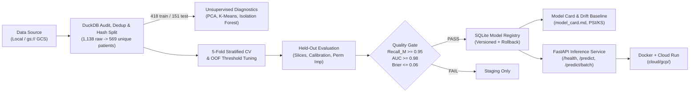

# Cancer MLOps — End-to-End Breast Cancer Risk Scoring System (GCP-Ready)

A production-oriented machine learning engineering project built on the breast cancer diagnostic dataset ([`data/Cancer_Data.csv`](data/Cancer_Data.csv)). It implements a leak-free, observable, containerized MLOps lifecycle designed for Google Cloud Platform (Cloud Run, Cloud Storage, Artifact Registry, Cloud Build, and Vertex AI).

---

## 1. Architecture Overview



---

## 2. Engineering Competency Alignment

| Domain | Implemented Capabilities | Key Modules |
|---|---|---|
| **Data Prep & SQL** | DuckDB SQL audit (`UNPIVOT`, skewness, 1.5x IQR outliers), pre-split SQL feature deduplication (`1,138 -> 569` unique patients), SHA-256 lineage, deterministic hash partition (`train=418`, `test=151`) | `sql/01_audit.sql`, `sql/02_partition.sql`, `src/cancer_mlops/data.py` |
| **Leak-Free Feature Pipelines** | Sklearn `Pipeline` transformers fitted strictly inside training folds (`FeatureEngineer`, `CollinearityPruner`, `QuantileBinner`, `DataFrameStandardScaler`) | `src/cancer_mlops/features.py` |
| **Unsupervised Learning** | Train-fitted PCA (7 comps = 90%, 10 comps = 95%), unlabeled K-Means (`k=2..8`, Test ARI = 0.6376), Isolation Forest anomaly detection | `src/cancer_mlops/unsupervised.py` |
| **Supervised & Custom Modeling** | L2 Logistic Regression, Statsmodels Logit (OR & VIF tables), Random Forest, HistGradientBoosting, plus custom CHAID tree with ordinal Bonferroni adjustment | `src/cancer_mlops/train.py`, `src/cancer_mlops/chaid.py` |
| **Clinical Evaluation & Thresholds** | CV out-of-fold threshold tuning targeting `Recall_M >= 0.96` (`F2` score), ROC/PR/calibration curves, subgroup slicing, permutation importance | `src/cancer_mlops/evaluate.py` |
| **MLOps Governance & Monitoring** | Zero-dependency SQLite `ExperimentTracker`, `ModelRegistry` with promote/rollback, `QualityGate`, `model_card.md`, PSI + KS batch drift + online Z-score alerts | `src/cancer_mlops/tracking.py`, `src/cancer_mlops/monitoring.py` |
| **Cloud & Serving (GCP)** | `StorageBackend` (`LocalStorage` + `GCSStorage` for `gs://`), FastAPI + Pydantic v2, non-root `Dockerfile`, CI workflow, Cloud Build & Cloud Run deploy scripts | `src/cancer_mlops/storage.py`, `src/cancer_mlops/api.py`, `cloud/gcp/` |
| **Agentic AI Workflow** | Repository invariants, prompt recipes, and human approval boundaries for coding/MLOps agents | `AGENTS.md` |

---

## 3. Verified Pipeline Results (Leak-Free, Deduplicated 569 Unique Patients)

All numbers below come directly from `py -m cancer_mlops.pipeline --stage all` on `data/Cancer_Data.csv` (1,138 raw rows → **569 unique patients** after pre-split SQL deduplication, `train=418` / `test=151`, SHA-256 prefix `aa47becd63cb`, 0 overlapping feature vectors across partitions).

### 3.1 Held-Out Test Performance (`cv_tuned` Clinical Thresholds)

| Model | Tuned Threshold | Accuracy | Recall_M | Precision_M | F1 | F2 | ROC-AUC | PR-AUC | Brier |
|---|---:|---:|---:|---:|---:|---:|---:|---:|---:|
| `random_forest` (CV Champion) | 0.32 | 0.9338 | 0.9825 | 0.8615 | 0.9180 | 0.9556 | 0.9853 | 0.9815 | 0.0427 |
| `hist_gbdt` | 0.13 | 0.9603 | 0.9825 | 0.9180 | 0.9492 | 0.9689 | 0.9965 | 0.9947 | 0.0182 |
| `logistic_statsmodels` | 0.17 | 0.9536 | 0.9825 | 0.9032 | 0.9412 | 0.9655 | 0.9961 | 0.9942 | 0.0235 |
| `logistic_l2` | 0.22 | 0.9536 | 0.9649 | 0.9167 | 0.9402 | 0.9549 | 0.9961 | 0.9942 | 0.0225 |
| `chaid_bonferroni` | 0.13 | 0.6689 | 1.0000 | 0.5327 | 0.6951 | 0.8507 | 0.9455 | 0.9029 | 0.0753 |
| `chaid_unadjusted` | 0.13 | 0.6689 | 1.0000 | 0.5327 | 0.6951 | 0.8507 | 0.9455 | 0.9029 | 0.0753 |

### 3.2 5-Fold Cross-Validation Summary (`cv_tuned`)

- `random_forest` (Selected Champion): Accuracy `0.9402`, Recall_M `0.9806`, ROC-AUC `0.9911`, Brier `0.0345`
- `logistic_l2`: Accuracy `0.9426`, Recall_M `0.9613`, ROC-AUC `0.9877`, Brier `0.0337`
- `logistic_statsmodels`: Accuracy `0.9402`, Recall_M `0.9613`, ROC-AUC `0.9874`, Brier `0.0346`
- `hist_gbdt`: Accuracy `0.9593`, Recall_M `0.9677`, ROC-AUC `0.9865`, Brier `0.0248`

### 3.3 Unsupervised & Monitoring Diagnostics

- **PCA**: 7 components explain 90% variance; 10 components explain 95% variance (PC1 = 44.55%, PC2 = 18.19%).
- **K-Means (`k=2`, unlabeled)**: Best silhouette `0.3415` at `k=2`; post-hoc alignment yields Train ARI = `0.6824`, Test ARI = `0.6376`.
- **Isolation Forest (5% contamination)**: Flagged train anomalies have `81.0%` malignancy rate vs `34.8%` in normal samples (12/21 anomalies overlap with 1.5x IQR `area_se` outliers).
- **Batch Drift Self-Check (`test=151` vs `train=418` baseline)**: Zero significant drift features (`max_psi = 0.164573`, all KS two-sample p-values `> 0.40`; minor `moderate_drift` PSI flags reflect finite-sample decile variance at `N = 151`).

### 3.4 Engineering Case Study: Eliminating Hidden Duplicate-Twin Leakage

1. **Root Cause Discovered During Data Audit**: Raw `Cancer_Data.csv` contains 1,138 rows (`A*` and `B*` ID prefixes) representing **569 exact duplicate feature-and-label pairs**. A naive 70/30 row-level split on `id_pat` leaked **74.2%** of test records (247/333) into the training set as identical twins, artificially inflating tree ensembles (`hist_gbdt` test AUC = `1.000`).
2. **Production Fix**: Added `data.deduplicate_features: true` using DuckDB SQL `QUALIFY ROW_NUMBER() OVER (PARTITION BY <30 features> ORDER BY id_pat) = 1` with label-conflict verification, deterministic `ORDER BY id_pat` before splitting, and an automated regression assertion in `tests/test_no_leakage.py` guaranteeing **0 shared feature signatures** between train and test.
3. **Impact**: Eliminated cross-partition memorization and produced honest generalization metrics (`Recall_M = 0.9825`, `ROC-AUC = 0.9853–0.9965` across the top models, with only 1 missed malignant case out of 57 on the held-out test set).

---

## 4. Quickstart

### 4.1 Run End-to-End Pipeline, Lint, and Tests (PowerShell)

```powershell
$env:PYTHONPATH = "src"
$env:PYTHONIOENCODING = "utf-8"

# Full lifecycle: audit -> unsupervised -> CV train -> test eval -> quality gate -> registry -> drift
py -m cancer_mlops.pipeline --stage all

# Static lint & unit/integration tests
ruff check src tests
py -m pytest -v
```

### 4.2 Run Local FastAPI Inference Server

```powershell
$env:PYTHONPATH = "src"
uvicorn cancer_mlops.api:app --host 0.0.0.0 --port 8080
```

Endpoints:
- `GET /health` — liveness & loaded model version
- `GET /model/info` — active production lineage, threshold, schema, and metrics
- `POST /predict` — single tumor record scoring with risk tier (`low`/`medium`/`high`), top feature contributions, and online Z-score/range drift warnings
- `POST /predict/batch` — batch inference with batch PSI/KS drift summary

### 4.3 Docker & GCP Cloud Run Deployment

```bash
# Local Docker build & run (after running --stage all so artifacts/ is populated)
docker build -t cancer-mlops-api:latest .
docker run --rm -p 8080:8080 cancer-mlops-api:latest

# Deploy to GCP Artifact Registry + Cloud Run
PROJECT_ID=<your-gcp-project> REGION=europe-west3 ./cloud/gcp/deploy_cloud_run.sh
```

See [`cloud/gcp/ARCHITECTURE.md`](cloud/gcp/ARCHITECTURE.md) for the full GCP service mapping and Vertex AI migration path.

---

## 5. Project Structure

```text
cancer_mlops/
├── .github/workflows/ci.yml        # GitHub Actions CI (ruff + pytest + pipeline smoke)
├── cloud/gcp/
│   ├── ARCHITECTURE.md             # GCP Cloud Run / GCS / Vertex AI blueprint
│   ├── cloudbuild.yaml             # Cloud Build CI/CD pipeline
│   └── deploy_cloud_run.sh         # Artifact Registry + Cloud Run deploy script
├── configs/default.yaml            # Central configuration
├── data/Cancer_Data.csv            # Diagnostic dataset (1,138 records x 32 cols)
├── sql/
│   ├── 01_audit.sql                # DuckDB profiling, missing, and IQR checks
│   └── 02_partition.sql            # Deterministic hash split view
├── src/cancer_mlops/
│   ├── api.py                      # FastAPI inference service
│   ├── chaid.py                    # Hardened CHAID with Bonferroni adjustment
│   ├── config.py                   # Pydantic v2 config & env overrides
│   ├── data.py                     # DuckDB loader, SHA-256 lineage, schema validator
│   ├── evaluate.py                 # Metrics, ROC/PR/calibration, slices, perm importance
│   ├── features.py                 # Leak-free sklearn feature transformers
│   ├── monitoring.py               # PSI, KS, and online Z-score drift detection
│   ├── pipeline.py                 # CLI orchestrator
│   ├── storage.py                  # Local & GCS (gs://) storage abstraction
│   ├── tracking.py                 # SQLite tracker, registry, quality gate, model card
│   ├── train.py                    # StratifiedKFold CV, tuning, threshold optimization
│   └── unsupervised.py             # PCA, K-Means, Isolation Forest analysis
├── tests/                          # Automated pytest suite (13 tests)
├── AGENTS.md                       # Agentic AI engineering workflow & boundaries
├── Dockerfile                      # Non-root Cloud Run container
├── pyproject.toml                  # Package, ruff, and pytest settings
└── requirements.txt                # Runtime & dev dependencies
```
