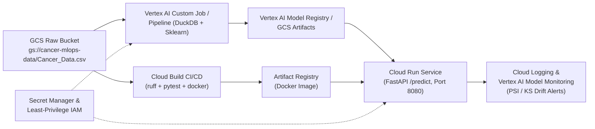

# GCP Production Architecture Blueprint

This document explains how the local `cancer_mlops` pipeline maps directly onto managed Google Cloud Platform (GCP) services for production training, governance, and low-latency online serving.

## 1. End-to-End Architecture

## 2. Local-to-GCP Component Mapping

| Concern | Local Implementation (`cancer_mlops`) | Managed GCP Production Equivalent |
|---|---|---|
| **Raw Data & Artifacts** | `LocalStorage` (`data/Cancer_Data.csv`, `artifacts/`) | `GCSStorage` (`gs://<project>-mlops-data/`, `gs://<project>-mlops-artifacts/`) |
| **SQL Audit & Deterministic Split** | DuckDB in-memory (`sql/01_audit.sql`, `02_partition.sql`) | DuckDB over GCS Parquet/CSV or BigQuery ELT views |
| **Experiment & Registry** | SQLite `ExperimentTracker` + `ModelRegistry` (`mlops.db`) | Vertex AI Experiments + Vertex AI Model Registry |
| **CI/CD & Container Registry** | `.github/workflows/ci.yml` + `Dockerfile` | Cloud Build (`cloudbuild.yaml`) + Artifact Registry |
| **Online Serving** | FastAPI + Uvicorn (`src/cancer_mlops/api.py`, `$PORT=8080`) | Cloud Run (autoscaling `0..N`, non-root container, `/health` probe) |
| **Data Drift Monitoring** | `monitoring.py` (PSI + KS + online Z-score warnings) | Vertex AI Model Monitoring + Cloud Monitoring log-based alerts |
| **Security & Governance** | `QualityGate`, `model_card.md`, non-root Docker user | Dedicated Cloud Run Service Account (read-only GCS/Registry), Secret Manager |

## 3. Operational Practices

1. **Switching to GCS Data Ingestion**:
   Set `CANCER_MLOPS_DATA_URI=gs://your-bucket/Cancer_Data.csv` and install `google-cloud-storage`. `storage.get_storage()` switches seamlessly from `LocalStorage` to `GCSStorage` without changing pipeline code.
2. **Quality Gate Before Promotion**:
   Cloud Build runs `ruff` and `pytest` before container packaging; the pipeline only promotes a candidate model to `production` when `Recall_M >= 0.95`, `ROC-AUC >= 0.98`, and `Brier <= 0.06`.
3. **Zero-Downtime Rollback**:
   In `ModelRegistry`, promoting a new version archives the prior production version. Instant rollback restores the prior bundle without retraining, or traffic splitting on Cloud Run revisions (`gcloud run services update-traffic`) shifts traffic back immediately.
